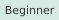
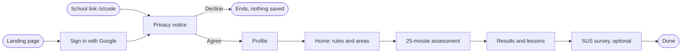
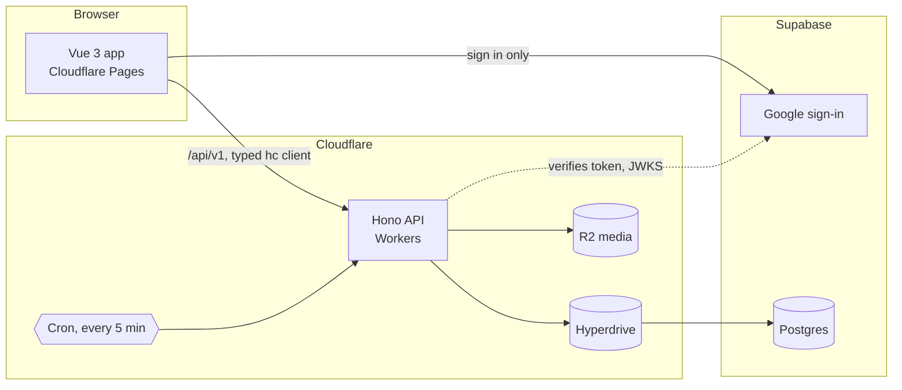
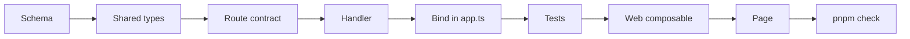

<div align="center">


# DigiBridge

**Find out where students stand online, and give them the lessons to close the gap.**

A digital literacy assessment for ACLC College of Mandaue students, built on DigComp 2.2.

[](https://vuejs.org)
[](https://hono.dev)
[](https://workers.cloudflare.com)
[](https://supabase.com)
[](https://www.typescriptlang.org)
[](https://tailwindcss.com)

[**Live app**](https://digibridge-web.pages.dev) · [PRD](docs/PRD.md) · [TRD](docs/TRD.md) · [Build plan](<docs/Build plan.md>) · [Design](docs/design.md)

</div>

---

## Why it exists

Students are often called "digital natives", but skills like spotting a phishing text, judging fake news or filling in an online form vary a lot, and nobody measures them. Without data, the school can't tell who needs help or with what.

DigiBridge is the working prototype for the study _DigiBridge: Digital Literacy Assessment Framework and Digital Inclusion_ by Group 2. It does three things:

| For students                                                                                                    | For the research team                                                                                                               | For admins                                                                                                    |
| --------------------------------------------------------------------------------------------------------------- | ----------------------------------------------------------------------------------------------------------------------------------- | ------------------------------------------------------------------------------------------------------------- |
| A 30-item, 25-minute scenario assessment, then their level in each area and lessons picked for them right away. | A dashboard of who is falling behind, broken down by age, sex, devices and internet access, plus course and year level for classes. | Questions, lessons, school links and respondents managed in the app, with CSV and Excel export for the paper. |

## How the assessment works

Every attempt covers 3 of DigComp 2.2's areas. Each area gets 10 questions, picked at random from the bank and shuffled, along with each question's 4 choices.

| Area                            | Basic (1 pt) | Intermediate (2 pts) | Advanced (3 pts) | Points |
| ------------------------------- | :----------: | :------------------: | :--------------: | :----: |
| Information and data literacy   |      4       |          4           |        2         |   18   |
| Communication and collaboration |      4       |          4           |        2         |   18   |
| Online safety                   |      4       |          4           |        2         |   18   |
| **Total**                       |    **12**    |        **12**        |      **6**       | **54** |

Each area's score, and the overall one, lands on one of 4 levels. The level decides which lessons the student sees first.

| Level                                               | Score      | Lessons recommended        |
| --------------------------------------------------- | ---------- | -------------------------- |
|          | below 40%  | Foundations                |
|                | 40% to 59% | Foundations → Intermediate |
|  | 60% to 79% | Intermediate → Advanced    |
|          | 80% and up | Advanced                   |

The timer runs on the server's clock, every answer saves the moment it's picked, and an attempt left open past its time is scored and closed by a cron job every 5 minutes. After results, students can rate the app on the 10-statement System Usability Scale (SUS).

> [!NOTE]
> All of these numbers live in [`packages/shared/src/assessment`](packages/shared/src/assessment). Change them there, never in the apps.

## Two ways in

|                 | Online                                             | School link                                                      |
| --------------- | -------------------------------------------------- | ---------------------------------------------------------------- |
| Who it's for    | Anyone who opens the site                          | ACLC classes the team chooses                                    |
| Sign-in         | Google                                             | None: the student opens `/s/<code>` on their own phone or laptop |
| Profile         | Name, date of birth, sex, devices, internet access | The same, plus student number, course and year level             |
| One attempt per | Google account                                     | Student number, across every link                                |
| Coming back     | Sign in again                                      | The browser remembers them until they press Done                 |

School details only ever exist on school links. The online side never asks for them, and the API refuses them.



Staff who walk through these pages get a **preview**: the same screens with a sample assessment, scored but never saved, so their tries stay out of the research data.

## Architecture



- **The browser talks to Supabase only to sign in.** Everything else goes through the API, which checks the role on every route.
- **Every table has row-level security on and no policies**, so the public key can't read or write anything. Only the API, as the table owner, touches data.
- **The API is the contract.** Routes are written with `createRoute` and Zod, so the same schemas check requests, build the [OpenAPI docs](http://localhost:8787/api/reference) and type the web app's client.
- **School students get a token, not an account.** It's 32 random bytes kept in their browser; the database keeps only its SHA-256 hash.

## What's in the repo

```text
apps/
├── web/                 Vue 3 SPA on Cloudflare Pages
│   └── src/
│       ├── pages/       landing, start, assessment, results, lessons, school, admin
│       ├── components/  shared UI, form fields, charts, admin widgets
│       ├── composables/ data loading and page logic (useResult, useRespondents, ...)
│       ├── stores/      Pinia: session, attempt, school link, preview
│       └── lib/         typed API client, markdown, levels, theme
└── api/                 Hono + OpenAPI on Cloudflare Workers
    └── src/
        ├── routes/      route contracts (createRoute + Zod)
        ├── handlers/    the logic behind each route
        ├── lib/         pure helpers: scoring, SUS, stats, item picking, CSV, XLSX
        ├── middleware/  auth, roles, rate limits, security headers, CORS
        └── test/        route tests on in-memory Postgres (PGlite)
packages/
├── shared/              Zod schemas, enums, scoring rules, privacy notices (used by both apps)
├── db/                  Drizzle schema (11 tables) and SQL seeds
└── config/              shared ESLint rules
supabase/                Supabase CLI project and SQL migrations
docs/                    PRD, TRD, build plan and design tokens
```

## Tech stack

| Part    | Tools                                                                                        |
| ------- | -------------------------------------------------------------------------------------------- |
| Web     | Vue 3, Vite, Vue Router, Pinia, Tailwind CSS v4, Chart.js, markdown-it + DOMPurify           |
| API     | Hono, `@hono/zod-openapi`, Zod 4, `jose`, postgres.js, Scalar API docs                       |
| Data    | Supabase Postgres and Auth (Google), Drizzle ORM, Cloudflare Hyperdrive and R2               |
| Tests   | Vitest, PGlite for an in-memory Postgres built from the real migrations                      |
| Tooling | Turborepo, pnpm workspaces and catalog, TypeScript 6, ESLint, Prettier, Husky + lint-staged  |
| CI      | GitHub Actions: format, lint, typecheck, test, build, dependency audit, gitleaks, actionlint |

## Getting started

You need **Node.js 22.22.1 or newer** and **pnpm 12**.

```sh
pnpm install
```

Then copy each example file and fill it in:

| File                 | From                         | What goes in it                                             |
| -------------------- | ---------------------------- | ----------------------------------------------------------- |
| `apps/web/.env`      | `apps/web/.env.example`      | Supabase URL and publishable key, the API's URL             |
| `apps/api/.dev.vars` | `apps/api/.dev.vars.example` | Admin emails, the web's origin, `API_DOCS=true`             |
| `apps/api/.env`      | `apps/api/.env.example`      | The database URL that `wrangler dev` connects Hyperdrive to |
| `packages/db/.env`   | `packages/db/.env.example`   | `DATABASE_URL` (session pooler, port 5432) for drizzle-kit  |

For practice data, run [`packages/db/seed/dev-questions.sql`](packages/db/seed/dev-questions.sql) and then [`lessons.sql`](packages/db/seed/lessons.sql) once in the Supabase SQL editor. Then start everything:

```sh
pnpm dev
```

| What              | Where                               |
| ----------------- | ----------------------------------- |
| Web app           | http://localhost:5173               |
| API               | http://localhost:8787/api/v1/health |
| API docs (Scalar) | http://localhost:8787/api/reference |

> [!TIP]
> Put your own Google email in `ADMIN_EMAILS` before you first sign in, and your account starts as an admin.

## Scripts

Run these from the repo root. For one package, add a filter: `pnpm --filter api test`.

| Command                        | What it does                                                    |
| ------------------------------ | --------------------------------------------------------------- |
| `pnpm dev`                     | Start the web app and API locally                               |
| `pnpm check`                   | Lint, typecheck, test and build everything (run before merging) |
| `pnpm test`                    | Unit tests plus the API's route tests                           |
| `pnpm format`                  | Format every file with Prettier                                 |
| `pnpm db:generate`             | Turn schema changes into a new SQL migration                    |
| `pnpm db:push`                 | Apply new migrations to the linked Supabase project             |
| `pnpm --filter web run deploy` | Build and upload the web app to Pages                           |
| `pnpm --filter api run deploy` | Deploy the API Worker                                           |

<details>
<summary><b>How the checks fit together</b></summary>

- **Before each commit,** Husky runs ESLint (with fixes) and Prettier on the staged files, and stops the commit on an error ESLint can't fix.
- **On every push** to `main` or `develop`, and on every pull request, GitHub Actions runs Format, Lint, Typecheck, Test and Build as separate jobs, plus a dependency audit, a gitleaks scan of the whole history and actionlint.
- **API route tests** run against PGlite, an in-memory Postgres built from the real migrations, so the schema's checks and indexes are tested too. Pure logic like scoring, SUS and stats has its own unit tests.

</details>

## Building a feature

Every feature follows the same path, so each layer is checked before the next one leans on it:



Requirement IDs from the PRD (`AUTH-01`, `ASM-03`, `LNK-04`, ...) tie the docs, tests, commits and bug reports together. Commits use Conventional Commits, like `feat(api): add school link close route`.

## Where it's at

| Stage                       | Status                                                                   |
| --------------------------- | ------------------------------------------------------------------------ |
| 0 · Foundation              | Done                                                                     |
| 1 · Respondent flow         | Done                                                                     |
| 2 · School links            | Done                                                                     |
| 3 · Admin side              | Done, except image uploads, CSV import and user roles, set aside for now |
| 4 · Real content and freeze | Done                                                                     |
| 5 · Pilot and defense       | Done                                                                     |

The full checklist is in the [build plan](<docs/Build plan.md>).

## Privacy

Respondents agree to a privacy notice before anything is saved, and can choose to hide their name (and student number) from the team. Declining saves nothing. All respondent data is deleted at the end of the semester, as the notice promises. Both notices are public at `/privacy`.

## Team and bugs

Built by **Cez** (sole developer), with **Morales** on QA and the rest of **Group 2** on content, interviews and the pilot.

Found a bug? Open a GitHub Issue with the PRD requirement ID, the steps, what you expected, what happened, and a screenshot.
