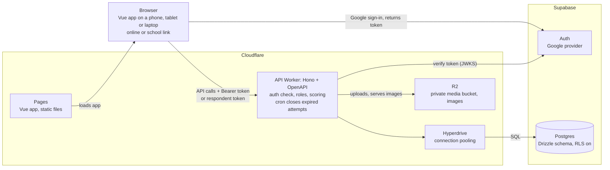

# DigiBridge TRD

Oct 30, 2026 · @Cornflakesxz

## Architecture



The browser talks to Supabase only to sign in. Everything else goes through the API Worker, which checks the token (a Supabase one, or a school-link student's respondent token), applies role rules and is the only part that reads or writes Postgres.

## Tech stack

TypeScript end to end: a Vue SPA on Cloudflare Pages calls a Hono API on Cloudflare Workers, which is the only thing that talks to Supabase Postgres.

| Layer | Choice | Why |
| --- | --- | --- |
| Monorepo | Turborepo with pnpm workspaces | One repo, shared types between web and API |
| Checks | GitHub Actions CI with `pnpm audit`, gitleaks and actionlint; Husky pre-commit hook running lint-staged | Every push to `main` or `develop` and every pull request runs the ship check, a dependency audit and a secret scan; ESLint and Prettier fix staged files before each commit |
| Frontend | Vue 3 with the Composition API in `<script setup>`, Vite, TypeScript | Team already knows Vue; logic reused through composables |
| Routing and state | Vue Router, Pinia | Route guards per role; small stores for session, consent, school link and attempt |
| Styling | Tailwind CSS v4 via `@tailwindcss/vite`, no component library | Full control; design straight in code |
| Charts | Chart.js with vue-chartjs | Radar chart for results, bar charts for the dashboard |
| Markdown | markdown-it with DOMPurify | Lesson bodies stored as Markdown, rendered safely |
| API client | Hono RPC client (`hc`) | Typed calls from Vue straight off the API's route types |
| API | Hono on Cloudflare Workers, split into `routes/` (definitions) and `handlers/` (logic) | Small, fast, built for Workers; routes stay short and readable |
| Validation and API docs | Zod with `@hono/zod-openapi`; OpenAPI spec and Scalar docs page set up in `openapi/` | Each route declares its input and output once, which validates requests and documents the API |
| Database | Supabase Postgres | Managed Postgres with auth in one place |
| ORM and schema changes | Drizzle ORM and drizzle-kit. Schema and seeds in `packages/db`; `pnpm db:generate` writes SQL migrations to the root `supabase/migrations`, and `pnpm db:push` (`supabase db push`) applies them to the linked Supabase project. The API's connection setup lives in `apps/api/src/config/db`. | One schema package any app can import; typed queries; schema changes applied with one command |
| DB connection from Workers | Cloudflare Hyperdrive in front of Supabase, postgres.js driver | Connection pooling so Workers don't open a new connection per request |
| Auth | Supabase Auth, Google provider | Google sign-in with no password handling |
| Token check in API | `jose` verifying the Supabase access token | Stateless auth on every request |
| File storage | Cloudflare R2, private `digibridge-media` bucket bound to the API as `MEDIA`; the API serves images at `/api/v1/media/:key` | Images for scenario items and lessons. Uploads go through the binding, so no storage keys; a public R2 bucket would need a custom domain |
| Scheduled jobs | Cloudflare Cron Trigger on the API Worker | Closes attempts whose time ran out |
| Hosting | Cloudflare Pages (web), Cloudflare Workers (API) | Free tier fits the pilot |
| Tests | Vitest: `app.test.ts` with `test-helpers.ts` for routes, run against PGlite (in-memory Postgres with the real migrations), plus unit tests for scoring | Fast, no server or database needed (`app.request()`); SQL and constraints still tested |

## Repository structure

Two apps and three shared packages. The web app imports the API's route types for the typed client but never its runtime code.

```
digibridge/
├─ apps/
│  ├─ web/                    Vue 3 (Composition API, <script setup>) + Vite → Cloudflare Pages
│  │  ├─ src/
│  │  │  ├─ pages/           one folder per route group: start, assessment, results, lessons, school, admin
│  │  │  ├─ components/      QuestionCard, CountdownTimer, QuestionGrid, RadarChart, SusForm, ResultsQr, StatCard, DataTable
│  │  │  ├─ composables/     useRespondentFlow, useCountdown, data loaders and form savers
│  │  │  ├─ stores/          session.ts, consent.ts, schoolLink.ts, attempt.ts
│  │  │  ├─ lib/             api.ts (hc client), supabase.ts, markdown.ts
│  │  │  ├─ router.ts        routes + role guards
│  │  │  └─ main.ts
│  │  └─ vite.config.ts
│  └─ api/                    Hono + OpenAPI → Cloudflare Workers
│     ├─ src/
│     │  ├─ config/db/       the API's database connection: Hyperdrive binding, postgres.js client, drizzle() instance
│     │  ├─ routes/          route definitions per feature: me, respondents, links, attempts, results, lessons, admin
│     │  ├─ handlers/        the logic behind each route
│     │  ├─ middleware/      auth, requireRole, respondent, cors, error handler
│     │  ├─ lib/             scoring.ts, sus.ts, shuffle.ts, stats.ts, csv.ts, helpers
│     │  ├─ openapi/         OpenAPI setup and API docs page
│     │  ├─ app.ts           builds the Hono app, mounts routes, exports AppType
│     │  ├─ index.ts         Worker entry: fetch + scheduled (cron)
│     │  ├─ app.test.ts      route tests
│     │  └─ test-helpers.ts  signed-in requests, test data
│     └─ wrangler.toml
├─ packages/
│  ├─ db/                     Drizzle schema and seeds (db:generate, db:seed)
│  │  ├─ src/schema/        tables, enums, relations
│  │  ├─ seed/              dev-questions.sql (3 areas and 39 practice items)
│  │  └─ drizzle.config.ts
│  ├─ shared/                 Zod enums, option lists and scoring constants used by web and api
│  └─ config/                 shared lint settings, used by the root eslint.config.ts
├─ supabase/                 Supabase CLI project: config.toml, migrations/ (written by drizzle-kit, applied by db:push)
├─ .github/
│  ├─ workflows/ci.yml       CI: checks, dependency audit, secret scan and workflow lint
│  └─ actions/setup/         shared CI step: pnpm, Node and pnpm install
├─ .husky/pre-commit          runs lint-staged (config in package.json) before each commit
├─ tsconfig.base.json         shared TypeScript settings; every app and package extends it
├─ eslint.config.ts           one lint config for the whole repo
├─ turbo.json
├─ pnpm-workspace.yaml
└─ package.json
```

Scoring constants live in `packages/shared` so the API, the tests and any display text use the same numbers. TypeScript settings live in the root `tsconfig.base.json`; each app or package's own `tsconfig.json` extends it and adds only what that package needs, such as the DOM types for `web` and `api`.

## Data model

11 tables in the `public` schema. Online and school-link respondents share one table, but they're keyed differently: an online respondent by their Google account (`profile_id`), a school-link respondent by student number, and their browser by the hash of its respondent token. School details (`student_number`, `course`, `year_level`), the token hash and the school link are filled only for school-link respondents and are null online, which a check constraint enforces.

**Enums**

- `role`: respondent, facilitator, admin
- `mode`: online, school
- `sex`: male, female, prefer\_not\_to\_say
- `difficulty`: basic, intermediate, advanced
- `level`: beginner, basic, intermediate, advanced
- `lesson_tier`: foundations, intermediate, advanced
- `attempt_status`: in\_progress, submitted, expired, voided

**Tables**

| Table | Key columns | Constraints and notes |
| --- | --- | --- |
| `profiles` | `id` (uuid, = `auth.users.id`), `email`, `full_name`, `avatar_url`, `role`, `created_at`, `last_sign_in_at` | Created on first API call after Google sign-in. `role` defaults to respondent. |
| `respondents` | `id`, `profile_id` (null for school links), `student_number`, `full_name`, `course`, `year_level`, `birth_date` (date), `sex`, `devices` (text\[\]), `internet_access` (text\[\]), `show_identity` (boolean), `access_token_hash`, `school_link_id`, `mode`, `consent_version`, `consented_at`, `created_at` | `student_number`, `course`, `year_level`, `access_token_hash` and `school_link_id` are nullable. Check `respondents_school_fields_by_mode`: school rows have all five and no `profile_id`; online rows have none of the five. `access_token_hash` (SHA-256 of the respondent token) unique when not null. `school_link_id` is the link the student joined through; it counts toward the link's limit and the dashboard's link filter (indexed). Check `respondents_birth_date_range`: age on the day of consent in Philippine time (`PROFILE_TIME_ZONE`) from `AGE_MIN` to `AGE_MAX`; the dashboard's age groups come from `birth_date` the same way (`ageOn` in `packages/shared`). The (`course`, `year_level`) index covers school rows only (`where course is not null`). `student_number` unique when not null, stored uppercase. `profile_id` unique when not null, so one respondent per Google account. `show_identity` false hides name and student number from all team views and the CSV. Consent is saved together with the profile, so declining stores nothing. |
| `school_links` | `id`, `code`, `school`, `label`, `created_by`, `course`, `year_level`, `max_responses`, `expires_at`, `closed_at`, `created_at` | Replaced `kiosk_sessions`. `code` (10 characters from `LINK_CODE_ALPHABET`) unique, for `/s/<code>`. `course` and `year_level` null for any; `max_responses` null for no limit. Status (open, closed, expired, full) is worked out when read by `linkStatus`; responses count the respondents who joined through it. `created_by` set to null if the admin's account is deleted. |
| `competency_areas` | `id`, `code`, `name`, `description`, `sort_order` | Seeded with 3 rows: `info_literacy`, `communication`, `safety`. |
| `questions` | `id`, `area_id`, `difficulty`, `stem`, `image_url`, `is_scenario`, `explanation`, `is_active`, `created_by`, `created_at`, `updated_at` | Never hard-deleted once answered; set `is_active` false instead. |
| `choices` | `id`, `question_id`, `label`, `is_correct`, `position` | Exactly 4 per question. Partial unique index on `question_id` where `is_correct` keeps 1 correct choice. |
| `attempts` | `id`, `respondent_id`, `school_link_id` (null online), `status`, `started_at`, `expires_at`, `submitted_at`, `question_order` (uuid\[\]), `choice_order` (jsonb), `total_points`, `overall_pct`, `overall_level`, `results_token`, `void_reason`, `voided_by` | Partial unique index on `respondent_id` where `status <> 'voided'` enforces one attempt. `expires_at` = `started_at` + 25 min. `results_token` (random, unique) is set at submit for the QR link. |
| `answers` | `attempt_id`, `question_id`, `choice_id`, `points`, `answered_at` | Primary key (`attempt_id`, `question_id`), so a changed answer overwrites. Foreign key (`question_id`, `choice_id`) to `choices`, so the choice belongs to the question. `points` filled at scoring. |
| `area_results` | `attempt_id`, `area_id`, `points`, `max_points`, `pct`, `level` | Primary key (`attempt_id`, `area_id`). Written once at submit. |
| `sus_responses` | `attempt_id`, `q1` to `q10` (smallint 1 to 5), `score` (numeric 0 to 100), `submitted_at` | Primary key `attempt_id`, so one SUS response per attempt. Only for submitted or expired attempts. |
| `lessons` | `id`, `area_id`, `tier`, `slug`, `title`, `summary`, `body_md`, `image_url`, `video_url`, `resources` (jsonb), `is_published`, `sort_order`, `updated_at` | `slug` unique. One published lesson per area and tier for the 9-lesson set. |

**Fixed option lists** (stored as text, validated by Zod in `packages/shared`)

Both modes:

- `devices`: smartphone, laptop, desktop, tablet, none
- `internet_access`: home\_wifi, mobile\_data, school\_wifi, piso\_wifi, none

School links only (the school details):

- `student_number`: trimmed and uppercased, must match `^[A-Z]\d{2}-\d{2}-\d{4}-[A-Z]{3}\d{3}$` (e.g. C23-01-7557-MAN121)
- `course`: BSIT, BSCS, BSBA, BSA, BSHM (regular, year 1 to 4); HRT, WADT (TESDA scholars, year 1 to 3)
- `year_level`: 1 to 4, and at most 3 for HRT and WADT, checked in the Zod schema and again in the API

`packages/shared` has two profile schemas: a general one for online, which rejects the school fields, and a school one that extends it with the three school fields, all required (`onlineRespondentSchema` and `schoolRespondentSchema` add the identity choice and the notice version). The school lists are ACLC's; keeping them in their own module means another school's lists could be added later without touching the online profile.

**Indexes for the dashboard:** `attempts(status, submitted_at)`, `respondents(course, year_level)`, `answers(question_id)` for item analysis.

## Auth, roles and school links

Every API request from a signed-in user carries a Supabase access token. School-link students have no Google account: saving their profile through a link gives their browser a respondent token, which it sends instead on their own routes.

**Sign-in (online respondents, facilitators, admins)**

1. The web app calls `supabase.auth.signInWithOAuth({ provider: 'google' })` and gets a session back on the redirect.
2. Every API call sends `Authorization: Bearer <access_token>`.
3. The `auth` middleware verifies the token with `jose` against the project's JWKS (`<SUPABASE_URL>/auth/v1/.well-known/jwks.json`, ES256 signing keys), then loads or creates the `profiles` row.
4. On first sign-in, if the email is in `ADMIN_EMAILS` and Google marks it verified, the role is set to admin. Everyone else starts as respondent. Later sign-ins don't change the role.
5. `requireRole('admin')` and `requireRole('facilitator', 'admin')` guard routes. The Vue router mirrors these guards for display only; the API is the real check.

**School links**

1. An admin makes a link on `/admin/links` (`POST /api/v1/admin/links`) and sends `/s/<code>` to the students the team chose.
2. A student opens it. `GET /api/v1/links/:code` gives the link's name and course and year-level lock while it's open; 404 for an unknown code, 410 `gone` when it's closed, expired or full.
3. After the school notice and profile, `POST /api/v1/links/:code/respondents` saves a `mode = school` respondent with the school details and `school_link_id`, under a `for update` lock on the link so a limit of 40 lets in 40. It returns a respondent token once: 32 random bytes, base64url. Only its SHA-256 hash is saved, in `access_token_hash`.
4. The `schoolLink` Pinia store keeps the code and token in `localStorage`. On `/s/:code/*` pages the student's calls send `X-Respondent-Token` and never the Google token (the client is picked per call, so a retry keeps it after the page changes); `GET /api/v1/links/:code` with it returns the student and their attempt even after the link closed, so a refresh or a later visit carries on.
5. The `respondent` middleware on the attempt routes takes `X-Respondent-Token` (it wins when both are sent) or a Google sign-in with the respondent role, and sets `c.var.respondentKey`. Handlers find the respondent by profile or by token hash in the same query, so it costs no extra round trip. The attempt stores the respondent's `school_link_id`. A student who joined can start and finish even after the link closes.
6. Done, after results (it opens the SUS survey first if it isn't answered), clears the token and the attempt from the browser. "Not you?" in the top bar does the same, for a shared phone or laptop.

**What each role can call**

| Route group | Respondent | Facilitator | Admin |
| --- | --- | --- | --- |
| `/api/v1/me`, own respondent and attempt | Yes | Yes | Yes |
| `/api/v1/lessons` (public read) | Yes | Yes | Yes |
| `/api/v1/links/:code`, `/api/v1/links/:code/respondents` (no sign-in) | Yes | Yes | Yes |
| `/api/v1/admin/links` | No | No | Yes |
| `/api/v1/admin/stats`, `/api/v1/admin/respondents` (read) | No | Yes, identity only if allowed | Yes |
| `/api/v1/admin/export`, questions, lessons, users, void attempt | No | No | Yes |

## API

All routes live under `/api/v1` (only the OpenAPI spec and docs page sit at `/api`), take and return JSON validated by Zod, and send errors as `{ error: { code, message } }`. "Self" means the signed-in respondent, or the school-link respondent whose token is sent as `X-Respondent-Token`.

**Respondent flow**

| Method | Path | Auth | Purpose |
| --- | --- | --- | --- |
| GET | `/api/v1/me` | Signed in | Profile, role, own respondent record and attempt status |
| POST | `/api/v1/respondents` | Respondent (online) | Save consent, profile and identity choice. Respondent role only (staff try the flow as a preview that saves nothing, 403 here), general profile only, 400 if school fields are sent, 409 if the account already has a respondent. |
| POST | `/api/v1/attempts` | Self | Start the attempt: pick items, shuffle, set `expires_at`. Returns the existing attempt if one is in progress. |
| GET | `/api/v1/attempts/:id` | Self | Items in shuffled order (no correct answers), saved answers, `expires_at`, server time |
| PUT | `/api/v1/attempts/:id/answers/:questionId` | Self | Save or change one answer. Rejected after `expires_at` + 30 s. |
| POST | `/api/v1/attempts/:id/submit` | Self | Score and close the attempt, create `results_token`. Safe to call twice. |
| GET | `/api/v1/attempts/:id/result` | Self | Overall and per-area scores, levels, recommended lessons (each tier for the area's level, with its published lesson or `null`), `results_token` and whether SUS is answered. No per-item marks. 409 while in progress or voided. |
| POST | `/api/v1/attempts/:id/sus` | Self | Save the 10 SUS answers and return the score. 409 `already_answered` if already answered, 409 `conflict` while in progress or voided. |
| GET | `/api/v1/results/:token` | Public | Results and lessons by private token, opened from the QR code (RES-04) |
| GET | `/api/v1/lessons` | Public | Published lessons, filterable by area and tier |
| GET | `/api/v1/lessons/:slug` | Public | One lesson |

**School links**

| Method | Path | Auth | Purpose |
| --- | --- | --- | --- |
| GET | `/api/v1/links/:code` | Public, optional respondent token | The link's school, name, course and year-level lock. 404 unknown code, 410 `gone` closed, expired or full. With the token of a student who joined it: their respondent and attempt, whatever the link's status; 401 for a token that isn't for this link |
| POST | `/api/v1/links/:code/respondents` | Public | Save consent to the school notice, the school profile and identity choice; returns the respondent token once. 400 for a course or year level outside the link's lock, 409 for a used student number, 410 `gone` if the link isn't open |
| GET, POST | `/api/v1/admin/links` | Admin | List links (status, responses) and make one |
| POST | `/api/v1/admin/links/:id/close` | Admin | Close a link |

School-link respondents use the same respondent-flow routes (`/api/v1/attempts/*`) with the `X-Respondent-Token` header.

**Admin**

| Method | Path | Auth | Purpose |
| --- | --- | --- | --- |
| GET | `/api/v1/admin/stats` | Facilitator, admin | Summary cards (including mean SUS and SUS count), level counts, SUS spread and statement averages, comparison by a `groupBy` field. Takes all dashboard filters as query params. A course, year-level or school link filter or grouping counts school respondents only. Age groups (17 and under, 18 to 20, 21 to 23, 24 and over) use the age on the consent day; the date range is the consent day too. |
| GET | `/api/v1/admin/respondents` | Facilitator, admin | Paged, filtered, sorted list. Name and student number show as Hidden unless the respondent allowed them. |
| GET | `/api/v1/admin/respondents/:id` | Facilitator, admin | Profile, area results and SUS answers of one respondent. Admins also get the answer sheet: each item in the order shown, with the choice picked and the right one |
| GET | `/api/v1/admin/items` | Admin | Item analysis: per question how many saw it, got it right or left it blank, picks per choice, and flags (too easy at 90% or more right, too hard below 20%, confusing when a wrong choice beats the right one; none until 5 have seen it). Takes the dashboard filters |
| GET | `/api/v1/admin/export.csv` | Admin | Filtered respondents with profile, area scores, levels and SUS score; hidden identities stay hidden |
| POST | `/api/v1/admin/attempts/:id/void` | Admin | Void an attempt with a reason |
| DELETE | `/api/v1/admin/respondents/:id` | Admin | Delete a respondent and their attempt on request |
| GET, POST | `/api/v1/admin/questions` | Admin | List with item analysis; create a question with its 4 choices |
| PATCH | `/api/v1/admin/questions/:id` | Admin | Edit. Correct choice locked once answered. |
| POST | `/api/v1/admin/questions/import` | Admin | Import CSV rows; returns created count and row errors |
| GET, POST | `/api/v1/admin/lessons` | Admin | List every lesson, drafts included; create a lesson. Publishing one unpublishes the lesson published for the same area and tier, in one transaction; the save's `replaces` names the lesson the admin agreed to replace (null for none), and anything else there is a 409. 409 for a slug in use; 404 if the areas were never seeded |
| GET, PATCH, DELETE | `/api/v1/admin/lessons/:id` | Admin | Read one lesson for the editor; edit any of its fields (publishing swaps as above); delete a draft (409 for a published lesson: unpublish it first) |
| POST | `/api/v1/admin/uploads` | Admin | Upload an image to the R2 `MEDIA` bucket; returns its `/api/v1/media/:key` URL |
| GET | `/api/v1/admin/users` | Admin | Accounts with role and last sign-in |
| PATCH | `/api/v1/admin/users/:id` | Admin | Change role. Refuses to demote the last admin. |

**System**

| Method | Path | Auth | Purpose |
| --- | --- | --- | --- |
| GET | `/api/v1/health` | Public | Check that the API is running |
| GET | `/api/v1/media/:key` | Public | Serve an uploaded image from R2, cached for a year (keys are random and never reused) |
| GET | `/api/openapi.json` | Public | OpenAPI 3.1 spec, built from the route definitions |
| GET | `/api/reference` | Public | API docs page (Scalar) for the spec above |

**Question import CSV columns:** `area_code, difficulty, stem, image_url, choice_a, choice_b, choice_c, choice_d, correct (a to d), explanation, is_scenario`. This matches the columns the content team uses in the shared sheet.

## Assessment engine

The server owns the item order, the clock and the score. The browser only shows items and sends answers.

**Start** (`POST /api/v1/attempts`)

1. Refuse if the respondent has a submitted or expired attempt that isn't voided.
2. If an attempt is in progress, return it instead of creating a new one.
3. For each area, take the active items: 4 basic, 4 intermediate, 2 advanced. If an area has more active items than that, pick randomly within each difficulty.
4. Shuffle the 30 items together with Fisher–Yates using `crypto.getRandomValues`, and shuffle each item's 4 choices.
5. Save `question_order`, `choice_order`, `started_at = now()` and `expires_at = now() + 25 min` in one insert.

**During the attempt**

- The browser shows the countdown from `expires_at` minus the server time sent with each response, so a wrong phone clock doesn't matter.
- Picking a choice sends `PUT /answers/:questionId` right away. The UI marks it saved on success and retries up to 3 times on failure, keeping the choice on screen.
- A refresh calls `GET /api/v1/attempts/:id` and restores the item order, saved answers and remaining time.
- The server rejects an answer for an item not in `question_order` or a choice that doesn't belong to that item.

**Submit and timeout**

- At 0 the browser calls `submit` by itself. The server also accepts saves up to 30 seconds past `expires_at` for answers already in flight.
- If the browser never submits (tab closed, phone died), a Cron Trigger every 5 minutes scores and closes attempts past `expires_at` + 30 s with `status = expired`.
- Submit is idempotent: a second call returns the saved result.

**Scoring** (`lib/scoring.ts`, pure function, unit tested)

```ts
const POINTS = { basic: 1, intermediate: 2, advanced: 3 } as const
const LEVELS = [
  { min: 80, level: 'advanced' },
  { min: 60, level: 'intermediate' },
  { min: 40, level: 'basic' },
  { min: 0,  level: 'beginner' },
] as const

// per area: pct = earned / 18 * 100 ; overall: pct = earned / 54 * 100
// level = first LEVELS entry where pct >= min
```

Scoring writes `answers.points`, one `area_results` row per area, and `total_points`, `overall_pct` and `overall_level` on the attempt, all in one transaction.

**Recommended lessons**

| Level in area | Lessons returned |
| --- | --- |
| Beginner | Foundations |
| Basic | Foundations, Intermediate (as next step) |
| Intermediate | Intermediate, Advanced (as next step) |
| Advanced | Advanced |

**SUS scoring** (`lib/sus.ts`, unit tested)

```ts
// a: the 10 answers (1 to 5) in statement order
const susScore = (a: number[]) =>
  a.reduce((sum, v, i) => sum + (i % 2 === 0 ? v - 1 : 5 - v), 0) * 2.5
```

Odd-numbered statements (index 0, 2, 4, ...) score answer minus 1, even-numbered ones score 5 minus answer, and the total times 2.5 gives 0 to 100. The score is computed on the server and saved in `sus_responses`.

## Frontend

One Vue app serves respondents (online and through school links) and admins, split by route guards.

**Route guards** (`router.ts`, `meta.requires`)

| Guard | Applies to | Rule |
| --- | --- | --- |
| `public` | `/lessons/*` | Anyone |
| `guest` | `/`, `/sign-in` | Signed out only, else to `/home` |
| `signedIn` | `/home`, `/start/*`, `/assessment`, `/results` | Supabase session required, else to `/sign-in` |
| `step` | `/home`, `/start/*`, `/assessment`, `/results` | Sends the user to the right step from `/api/v1/me` (no profile → consent; attempt submitted → results) |
| `school` | `/s/:code/*` | No sign-in. Loads `GET /api/v1/links/:code` (with the stored token), shows `ErrorScreen` for an unknown, closed, expired or full link, and runs the same steps from the link's state. A browser that joined one link is sent back to it |
| `staff` | `/admin`, `/admin/respondents` | Role facilitator or admin |
| `admin` | `/admin/questions`, `/admin/lessons`, `/admin/users`, `/admin/links` | Role admin |

The consent, profile, home, assessment and results pages serve both modes, through `useRespondentFlow` (which respondent and attempt, which notice, where each step lives). Through a school link the profile adds student number, course and year level, fixed when the link sets them.

**Stores**

| Store | Holds | Persisted |
| --- | --- | --- |
| `session` | Supabase session, `/api/v1/me` result, role | Supabase handles it |
| `consent` | Which account (or school link) agreed to which notice version, until the profile saves it | Memory only, so declining or a refresh saves nothing |
| `schoolLink` | The link open now, the student's code and respondent token, their respondent and attempt | The code and token in `localStorage`, cleared by Done or "Not you?" |
| `attempt` | Attempt ID, items, answers, `expiresAt`, server time offset, current index | Memory only; refetched on reload |

**Key components**

- `QuestionCard`: item text, optional image, 4 radio choices, saved indicator
- `CountdownTimer`: mm:ss, turns amber at 5 minutes and red at 1 minute, fires `expired`
- `QuestionGrid`: 30 numbered cells, answered or unanswered, tap to jump
- `SubmitDialog`: unanswered count and confirm
- `RadarChart`: 3 axes, 0 to 100, over rings colored by level (Chart.js; the results page is lazy-loaded so the first load stays small)
- `LevelBadge`, `ScoreBar`, `LessonCard`
- `StatCard`, `FilterBar`, `BarChart`, `DataTable` for the dashboard
- `MarkdownEditor`: textarea with live preview for lessons

Also: `SusForm` (10 statements, each a row of 5 radio buttons, Submit and Skip) and `ResultsQr` (QR code of the private results link, drawn with the `qrcode` package).

**Styling rules:** Tailwind v4 with design tokens in `@theme` (colors, radius, font). Mobile first. Tap targets at least 44 px. Choices are full-width buttons wrapping real radio inputs.

## Security and privacy

The browser never talks to the database directly, and only the fields the study needs are collected.

- **No direct database access.** Row Level Security is on for every `public` table with no policies, so the Supabase publishable key can't read or write any table. Only the API reaches the database, through Hyperdrive with a server-side connection string.
- **Correct answers never leave the server** during an attempt. `GET /api/v1/attempts/:id` returns choices without `is_correct`, and results show levels and scores, not per-item marks (RES-05).
- **Every input is validated** with the shared Zod schemas. Markdown is rendered with markdown-it and cleaned with DOMPurify.
- **CORS** allows only the Pages domain (and `localhost` in development).
- **Respondent tokens** are 32 random bytes; only their SHA-256 hash is stored, so the database can't be used to take over a student's attempt. A lost token can't be recovered: the same student number is refused, and the team helps.
- **Uploads** accept only PNG, JPEG and WebP up to 2 MB.
- **Data Privacy Act of 2012:**
  - Consent notice versioned (`consent_version`) and stored with a timestamp. Online and school links show different notice text: the online notice is general (no mention of a school), and the school notice adds the school details, the key the browser keeps and its own retention.
  - Online collects no school details at all; the API refuses them.
  - Name and student number are shown to the team only if the respondent allowed it (show\_identity). Otherwise they read Hidden everywhere, including the CSV.
  - CSV export is admin only.
  - Respondent deletion on request (USR-03).
  - Online respondent data deleted at the end of the semester (December 2026); school-link data after 30 days (`SCHOOL_DATA_KEPT_DAYS`).
- **Secrets** (`DATABASE_URL`, Supabase keys) live in Wrangler secrets and local env files, never in the repo.

## Environments and deployment

Two environments: local for building, production for the pilot and defense. There is no staging; Morales tests on production before the freeze, then test data is cleared.

**Environment variables**

| Variable | Where | Value |
| --- | --- | --- |
| `VITE_SUPABASE_URL` | web | Supabase project URL |
| `VITE_SUPABASE_PUBLISHABLE_KEY` | web | Publishable key, `sb_publishable_...` (safe because RLS blocks every table) |
| `VITE_API_URL` | web | API Worker URL |
| `SUPABASE_URL` | api | Supabase project URL, used to fetch the JWKS |
| `HYPERDRIVE` binding | api | Hyperdrive config `digibridge-db` pointing at the Supabase direct connection (`db.<project-ref>.supabase.co:5432`) |
| `MEDIA` binding | api | R2 bucket `digibridge-media` |
| `CLOUDFLARE_HYPERDRIVE_LOCAL_CONNECTION_STRING_HYPERDRIVE` | local only | In `apps/api/.env`; `wrangler dev` connects `HYPERDRIVE` straight to this (the session pooler string) |
| `DATABASE_URL` | local only | Supabase session pooler string (port 5432) for drizzle-kit and seeds, in `packages/db/.env` |
| `ADMIN_EMAILS` | api | Comma-separated emails that become admin on first sign-in |
| `WEB_ORIGIN` | api | Pages URL for CORS, `https://digibridge-web.pages.dev` |

Local values live in `apps/web/.env`, `packages/db/.env`, `apps/api/.dev.vars` and `apps/api/.env`, each copied from its committed `.example`. In production the API's public values (`SUPABASE_URL`, `WEB_ORIGIN`) are `[vars]` in `wrangler.toml` and its secret (`ADMIN_EMAILS`) is a Wrangler secret (`wrangler secret put <NAME>`). The web's `VITE_*` values are baked in at build time from `apps/web/.env` plus `apps/web/.env.production` (the production `VITE_API_URL`). The API's types for them are in `apps/api/src/env.ts`.

**One-time setup**

1. Create the Supabase project. Enable the Google provider with a Google Cloud OAuth client. Add the Pages URL and `localhost` to the redirect URLs.
2. Create the R2 bucket: `wrangler r2 bucket create digibridge-media`, bound as `MEDIA` in `wrangler.toml`.
3. Link the repo to the project: `pnpm exec supabase login`, then `pnpm exec supabase link --project-ref <project-ref>`. Copy `apps/web/.env.example` and `packages/db/.env.example` to `.env` and fill them in.
4. Create the Hyperdrive config from the Supabase direct connection string (`wrangler hyperdrive create digibridge-db --connection-string=...`) and bind it as `HYPERDRIVE` in `wrangler.toml`.
5. Create the Pages project as a direct-upload project: `wrangler pages project create digibridge-web --production-branch main --force` (`--force` makes a classic Pages project; without it Wrangler now makes a Worker). The project name sets the subdomain: `https://digibridge-web.pages.dev`.
6. Add a cron trigger `*/5 * * * *` to the API Worker in `wrangler.toml`.

**Deploying**

- **Web:** run `pnpm --filter web run deploy`: `vite build`, then `wrangler pages deploy dist` to the `digibridge-web` project. Pages isn't connected to Git, so a push doesn't deploy.
- **API:** run `pnpm --filter api run deploy`, which is `wrangler deploy`, to `https://digibridge-api.casupananjohncez.workers.dev`. Use `run`: `pnpm --filter api deploy` would run pnpm's own `deploy` command.
- **Database:** change the schema in `packages/db`, run `pnpm db:generate` to write a migration to `supabase/migrations`, read the SQL, then `pnpm db:push` (`supabase db push`) to apply it to the linked project. `pnpm db:status` lists which migrations are applied. Never edit a migration that has been pushed; generate a new one. Push before deploying an API change that needs it. The API picks up the new types through its import of `packages/db`; its connection setup in `config/db` doesn't change.
- **Careful after Nov 11:** once real pilot data exists, read each generated migration before pushing. A migration can drop or rename columns that hold respondent data.
- **Seeds:** `packages/db/seed/dev-questions.sql` loads the 3 areas and 39 practice items (5 basic, 5 intermediate and 3 advanced per area, so attempts still pick at random), for development and testing only. Run it once in the Supabase SQL editor after `db:push`; running it again adds nothing. Its items' IDs start with `de000000-`, so they can be switched off before the pilot. The route tests load it too and check its mix.

**Before the pilot (Nov 11):** deactivate the practice items (`update questions set is_active = false where id::text like 'de000000-%'`), delete test respondents and attempts, and confirm 10 active items per area.

## Testing and QA

The scoring and shuffling logic gets unit tests; everything else is covered by Morales's manual test cases mapped to the PRD requirement IDs.

**Automatic checks**

- **Before each commit:** Husky runs lint-staged on the staged files: `eslint --fix` then Prettier on `.ts` and `.vue` files, Prettier on everything else. A lint error stops the commit. `git commit --no-verify` skips the hook in an emergency; CI still runs.
- **CI:** `.github/workflows/ci.yml` runs on every push to `main` or `develop` and every pull request. Each job installs through `.github/actions/setup` (pnpm, Node 25, `pnpm install --frozen-lockfile`) and shows as its own check:
  - **Format:** `pnpm format:check`.
  - **Lint, Typecheck, Test, Build:** `pnpm turbo run <task>`, with Turbo's cache kept between runs so unchanged packages are skipped.
  - **Dependency audit:** `pnpm audit --audit-level high` fails on high or critical advisories.
  - **Secret scan:** gitleaks checks the whole Git history for API keys, tokens and passwords.
  - **Workflow lint:** actionlint checks the workflow files.

  Merge a pull request only when every check is green.

**Unit tests (Vitest, Cez)**

- Scoring: all correct = 100% Advanced; all wrong = 0% Beginner; boundaries at 39.9, 40, 59.9, 60, 79.9 and 80; unanswered counts as 0.
- Level-to-lesson mapping for all 4 levels, and SUS scoring (all 3s = 50, best answers = 100, worst answers = 0).
- Item selection always gives 4 basic, 4 intermediate and 2 advanced per area.
- Shuffle keeps all 30 items and all 4 choices, with no duplicates.

Route tests live in `apps/api/src/app.test.ts`. They call `app.request()` directly, so no server or Worker runtime is needed, and use `test-helpers.ts` to build signed-in requests for each role. Each Must endpoint gets at least one test for success and one for a blocked role.

**Manual test cases (Morales)**

One case per Must requirement, written as ID, steps, expected result, pass or fail. The ones that matter most:

| Case | What to check |
| --- | --- |
| One attempt | Same Google account twice online: the second goes to results. Same student number through two school links: the second is blocked |
| School details | The online profile has no student number, course or year level fields; posting them to the API gives 400. The school-link profile can't be saved without them |
| Resume | Answer 10 items, refresh, close and reopen: answers and timer intact |
| Timeout | Wait out the timer (set to 2 minutes on a test build): auto-submits; a closed tab is closed by the cron within 5 minutes |
| Shared device | Finish as student A through a link, press Done, open the link as student B: nothing from A visible |
| Closed link | Close or let a link expire: a new student gets the plain message; a student who already joined can still finish |
| Role checks | Respondent calls an admin endpoint: 403. A respondent who chose to hide their identity shows as Hidden on the dashboard and in the CSV |
| Scoring | Answer a known pattern, compare against a hand-worked score |
| Devices | Full run on a low-end Android phone on mobile data, an iPhone, and a laptop |
| Load | 10 people start at the same time: no errors, saves under 500 ms |

Bugs go in GitHub Issues with the requirement ID, steps, expected and actual result, and a screenshot.

## Technical risks

| Risk | Effect | Fallback |
| --- | --- | --- |
| Hyperdrive or Drizzle setup with Supabase takes longer than planned | Day 1 lost on plumbing | Use the Supabase transaction pooler connection string directly with postgres.js, add Hyperdrive later |
| Weak signal during in-person sessions | Saves fail, students wait | Autosave retries; bring a pocket Wi-Fi or phone hotspot for in-person sessions |
| Google sign-in blocked in Messenger's in-app browser | Online respondents can't sign in | Show an "Open in Chrome or Safari" notice when the in-app browser is detected |
| Content arrives late (Nov 6 to 8) | Real assessment not ready | Build and test on dummy items; CSV import makes loading real content a 10-minute job |
| Cloudflare free-tier limits | Requests blocked | 30 to 100 respondents is far below the free limits; watch usage in the dashboard |
| Someone takes it twice with a fake student number (school link) | Duplicate data | Student number format check; links go only to chosen students, can be locked to a course and year level and given a limit; admin can void |
| Someone takes it twice online with a second Google account | Duplicate online data | Online data isn't the study's ACLC sample; the dashboard can filter by mode; admin can void |
| One developer | Cez sick or busy | Keep the repo, `.env.example` and this TRD current so Morales can take over fixes |
